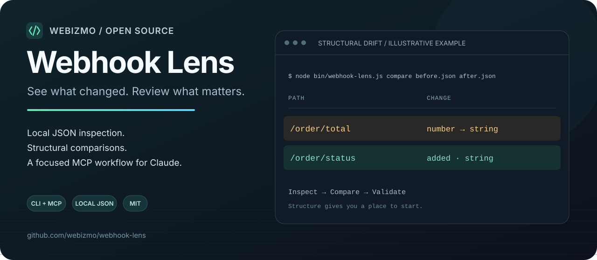

<p align="center">
  
</p>

# Webhook Lens

**Entegrasyonunuzu değiştirmeden önce webhook'ta neyin değiştiğini görün.**

Webhook Lens, yerel JSON dosyalarını incelemek için geliştirilen bir komut satırı aracı ve Claude ile kullanılabilen bir MCP sunucusudur. İki payload arasındaki yapısal farkları bulur; alan eklemelerini, alan kaldırmalarını ve tip değişikliklerini gösterir. JSON Schema ile doğrulama da yapabilirsiniz.

[English documentation](README.md) · [Claude kurulumu](docs/claude.md) · [Katkıda bulunma](CONTRIBUTING.md)

## Ne işe yarar?

Ödeme sağlayıcınız `amount` alanını sayı yerine metin göndermeye başladı. Daha önce gelen bir alan artık yok. İç içe bir nesne bu kez `null` geldi. Webhook Lens, bu farkları incelemenizi ve Claude ile değerlendirebilmenizi sağlar.

- **İnceleme:** JSON içindeki alan yollarını, tipleri ve yapıyı görün.
- **Karşılaştırma:** Eklenen, kaldırılan veya tipi değişen alanları bulun.
- **Doğrulama:** Payload'ı yerel bir Draft-07 JSON Schema dosyasına karşı kontrol edin.
- **Claude bağlantısı:** Yalnızca belirlediğiniz örnek dizinini MCP araçlarına açın.
- **Maskeleme:** Paylaşmadan önce CLI üzerinden ayrı bir kopyada maskeleme uygulayın ve sonucu inceleyin.

Araç elinizdeki JSON dosyalarıyla çalışır. Canlı webhook toplamaz veya istekleri yeniden göndermez.

## Hızlı başlangıç

**Node.js 22 veya üzeri** ve Git gerekir. Bağımlılık kurulumu npm kayıt sistemine erişir; payload işlemleri yerel olarak yapılır.

```sh
git clone https://github.com/webizmo/webhook-lens.git
cd webhook-lens
npm ci

node bin/webhook-lens.js demo
node bin/webhook-lens.js inspect examples/order.created.json
node bin/webhook-lens.js compare examples/order.created.json examples/order.updated.json
node bin/webhook-lens.js validate examples/order.created.json --schema examples/order.schema.json
```

Depodaki örnekler yapay veriden oluşur. Kendi verilerinize geçmeden önce bunlarla deneyin.

## Claude ile kullanın

Claude Code'a MCP sunucusunu ekleyin. Aşağıdaki iki yolu bilgisayarınızdaki **mutlak yollarla** değiştirin:

```sh
claude mcp add --transport stdio webhook-lens -- \
  node /absolute/path/webhook-lens/bin/webhook-lens.js mcp \
  --root /absolute/path/fixtures
```

`fixtures` dizinine yalnızca Claude'un araçlar üzerinden incelemesini istediğiniz JSON örneklerini ve şemaları koyun. Projenizin tamamını veya kullanıcı ana dizininizi bu amaçla açmayın.

Örnek istek:

> Webhook Lens ile `order.before.json` ve `order.after.json` dosyalarını karşılaştır. Eklenen, kaldırılan ve tipi değişen alanları açıkla. Entegrasyonda hangi varsayımları kontrol etmem gerektiğini öner.

| MCP aracı | İşlev |
| --- | --- |
| `inspect_payload(file)` | JSON dosyasının yapısal bilgisini döndürür. |
| `compare_payloads(before, after)` | İki JSON dosyasının yapısını karşılaştırır. |
| `validate_payload(file, schema)` | JSON dosyasını yerel Draft-07 şemaya göre doğrular. |

MCP sonuçları alan yolları, tipler, sayılar ve doğrulama bilgilerini içerir. Ham payload değerlerini okuyan veya dosya maskeleyen bir MCP aracı yoktur. **Dönen yapısal bilgiler Claude'a iletilir; alan adları ve yolları da hassas bilgi içerebilir.**

Ayrıntılar için [Claude kurulum rehberine](docs/claude.md) bakın.

## Paylaşmadan önce maskeleyin

```sh
node bin/webhook-lens.js redact input.json --output redacted.json
```

Mevcut bir çıktı dosyasının üzerine yazılmaz. Maskeleme mümkün olduğunca hassas veriyi bulmaya çalışır; anonimleştirme garantisi vermez. Beklenmedik anahtarlarda veya serbest metin içinde hassas bilgi kalabilir. Paylaşmadan önce çıktı dosyasını kendiniz inceleyin; mümkünse yapay veri kullanın.

## Sınırlar

- Yerel JSON dosyalarıyla çalışır; servis hesabı veya API anahtarı istemez.
- Payload işleme sırasında ağ isteği göndermez. MCP istemcisinin sonuçları nasıl işlediği ayrıca değerlendirilmelidir.
- MCP erişimi açıkça verilen kök dizinin altındaki JSON dosyalarıyla sınırlıdır.
- Şema doğrulaması Draft-07 destekler. Yalnızca aynı belge içindeki `#/definitions/order` gibi şema referansları desteklenir; diğer yerel dosyalara veya uzak şemalara referans verilmez.
- Yapısal fark olmaması, entegrasyonun sorunsuz çalışacağını kanıtlamaz. Aynı tipteki farklı bir değer de davranışı değiştirebilir.
- Birkaç örneğin incelenmesi, sağlayıcının tüm olaylarının aynı yapıda olduğunu kanıtlamaz.

[Güvenlik ve bildirim bilgileri](SECURITY.md).

## Katkıda bulunun

Küçük ve yapay JSON örnekleriyle hazırlanan hata raporları çok yardımcı olur. [Katkı rehberini](CONTRIBUTING.md) okuyabilir, [hata veya özellik isteği açabilirsiniz](https://github.com/webizmo/webhook-lens/issues/new/choose).

Araç işinize yaradıysa yıldız vererek daha fazla geliştiricinin keşfetmesine yardımcı olabilirsiniz.

## Webizmo tarafından geliştirildi

Webizmo; web siteleri, iş yazılımları ve API entegrasyonları geliştirir. Bu açık kaynak araç, entegrasyon çalışmalarını daha kolay incelemek ve değerlendirmek için hazırlanmıştır.

Webhook'larınızı güvenilir bir iş akışına dönüştürmek için [Webizmo ile çalışın](https://webizmo.tr/api-entegrasyon?utm_source=github&utm_medium=referral&utm_campaign=webhook_lens&utm_content=readme_tr).

Anthropic ile bağlantılı olmayan, bağımsız bir topluluk projesidir. Claude, Anthropic'in ürünüdür.

[MIT lisansı](LICENSE).
